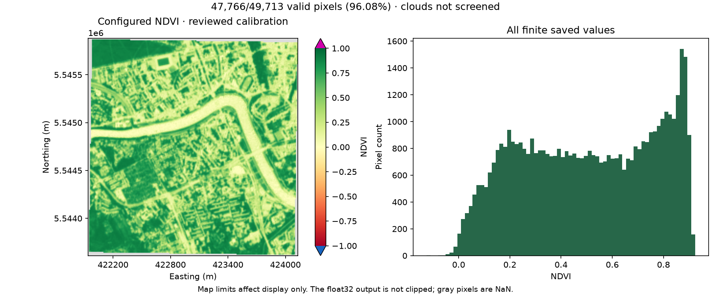

# Configured Lab 04 execution and reuse

Configuration: `config/ndvi.yml`, using the explicitly selected main-AOI inputs
from the copied Lab 03 catalogue. This is separate from the earlier demo evidence.

1. `plan` resolved the request without registering a request or an attempt.
2. The first `run` succeeded and published one NDVI raster.
3. The second `run` recorded reuse with a distinct attempt ID, the same request,
   the same artifact/path, and unchanged output checksum and modification time.

Request: `request-4da4b31ee2bad39bf44037154f70e5ae57c6e53a851a999e7a261be8321f2977`

| Invocation | Attempt ID | Status |
|---|---|---|
| First | `attempt-0a63120790f345c98a1c672da02ae0d3` | succeeded |
| Second | `attempt-08e57d3fa0724d43a401d39d57e40d36` | reused |

Artifact: `output-fa5be761901a1c4a26888f740f8507e21178c0aff13f9dff955866b2bf7c41c0`

## Raster inspection

- Shape: 227 × 219; CRS: EPSG:32634; native 10 m grid.
- One float32 band, NaN nodata, scale 1 and offset 0.
- Valid pixels: 47,766 / 49,713
  (96.0835%); NaN pixels: 1,947.
- Minimum: -0.125256673; maximum: 0.923467040;
  mean: 0.505540013; median: 0.511230588.
- Values outside [-1, 1]: 0; infinite values: 0.
- Stored bytes: 160,707; SHA-256: `0bb272ca3b35ca8e22520f474821608a8be75c39dd3a593091083125d0ef93f6`.

The saved array matches an independently evaluated calibrated NDVI formula and
nodata/absolute-denominator mask. Metadata and pixel transform match the source
grid. No inputs were modified. The display uses fixed limits but does not clip
the raster or discard finite values from the histogram.

Provenance tags identify the common request, original producing attempt,
`STAGE=ndvi_v1`, `MASK_POLICY=nodata_only` and `CLOUD_SCREENED=false`.
The reused invocation returns that producer's artifact; it does not rewrite its
provenance tags to claim new production.

This uses the hash-specific reviewed calibration documented in
configuration_review.json. Nodata coverage is not cloud-free coverage, and the
review is a teaching interpretation rather than an independent source-product
radiometric validation.

Full CLI responses, IDs and validation evidence: configured_execution.json.
Database report: configured_main_report.json. Runtime raster/database/log files
remain local and ignored by Git.
