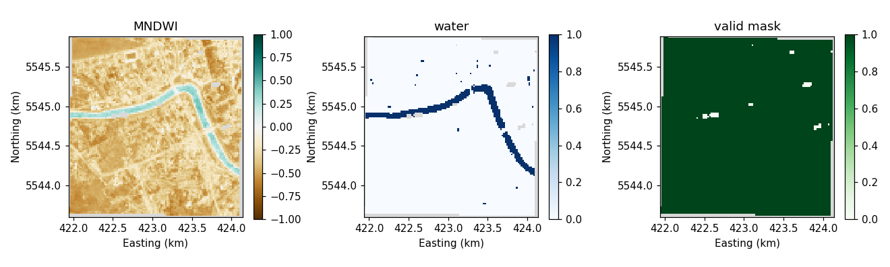

# Lab 06 · A processing package we can extend

Today we move from a collection of lab scripts to a shared processing package. The consolidation is supplied as Version 1. Your task is to understand its boundaries, investigate its output, and add a scientific product without changing the shared core.

The supplied example maps candidate water using MNDWI. You will also choose a different scientific product and one or more AOIs suited to a question you want to investigate. A short equation can support a substantial processing workflow: the important work includes preparing its inputs and explaining what the result actually measures.

Allow about two hours for the common exercise. Finish the personal product and its investigation after class.

## 1. Establish a working reference · 15 minutes

Follow the quick start in `README.md`. Run the demo, assess its results, and generate the report. Keep these outputs as your reference.

Before running it a second time, predict the number of new processing attempts. Then run the same manifest again. Inspect the catalogue or JSON output to check your prediction.

In `submission/report.md`, record the package version, the number of expected requests, how many attempts the first run created, and how many the second run created. Explain why six requests here represent three acquisition dates.

## 2. Follow one request through the package · 15 minutes

Open `eo_processing/products.py` and read `MNDWI`. Find its input bands, parameters, output roles and calculation. Then locate the call to `product.calculate` in `runner.py`.

Trace these responsibilities:

| Question | Module to inspect |
|---|---|
| Which scene, inputs and scientific settings are requested? | `planning.py` |
| How are raw values, clouds and different grids handled? | `preparation.py` |
| Where is the scientific calculation defined? | `products.py` |
| Who creates attempts, verifies outputs and reuses them? | `runner.py` |
| Where are history and artifact locations recorded? | `database.py` |
| Who decides whether coverage is sufficient? | `qc.py` |

Explain how you would add an optical product that requires three bands. Identify the declaration that changes, the inputs that need acquiring, and the parts of the runner that can already handle it. Do this before editing your own extension.

### Optional debugging clinic · 10–15 minutes

Follow [exercises/file_flush/README.md](exercises/file_flush/README.md) to investigate a real error from the preparation of this lab. Read its traceback, explain the file mode problem, apply a small correction to an extracted function and verify that the output survives unchanged. This is a useful short class discussion before starting your own extension. It can replace part of the module tracing discussion if time is tight.

The harness reproduces the relevant Windows rule on every operating system. Only the exercise file is edited; the shared core already contains the correction. It adds no extra marks or scientific product requirement.

## 3. Investigate MNDWI and its preparation · 25 minutes

For this example, MNDWI = (green − SWIR1) / (green + SWIR1). Sentinel-2 B03 supplies green and B11 supplies SWIR1. Read the source reference in `docs/SOURCES.md`.

The processor converts stored values to reflectance, screens native band pixels with SCL, aligns observations to a 20 m grid, calculates MNDWI, applies a threshold and measures candidate water area. It writes `index.tif`, `water.tif`, and `valid_mask.tif` for each attempt. A receipt records the parameters and measured QC.



The water layer uses 1 for candidate water, 0 for observed pixels below the threshold, and NaN for unknown pixels. A cloudy pixel contributes to neither class. The area calculation uses 400 m² per 20 m grid cell. This is a grid estimate, with mixed boundary pixels and classification uncertainty.

Compare the cloudy 4 June request and clearer 5 June request for the river AOI. Record raw coverage, usable coverage and candidate water area for both. Explain why the difference in detected area is insufficient evidence of a real water extent change. What would you need to compare them fairly?

Now run the diagnostic example with cloud screening disabled:

```bash
python -m eo_processing plan --config config/mndwi_nodata_only.json --out work/demo/nodata_batch.json
```

```bash
python -m eo_processing run --manifest work/demo/nodata_batch.json
```

```bash
python -m eo_processing assess --manifest work/demo/nodata_batch.json
```

```bash
python -m eo_processing report --manifest work/demo/nodata_batch.json --out work/demo/nodata_report
```

Compare that result with the screened request for the same scene. Explain why a large fraction of finite values does not establish scientific usefulness. Diagnostic `nodata_only` still excludes SCL missing and defective pixels, but it does not exclude clouds.

## 4. Change a scientific parameter · 15 minutes

Use the supplied example with a water threshold of 0.15:

```bash
python -m eo_processing plan --config config/mndwi_threshold015.json --out work/demo/threshold015_batch.json
```

```bash
python -m eo_processing run --manifest work/demo/threshold015_batch.json
```

```bash
python -m eo_processing report --manifest work/demo/threshold015_batch.json --out work/demo/threshold015_report
```

Compare the water area with the original threshold 0.0 for 5 June. Both are candidate classifications. Explain how you would select or validate a threshold for your scientific purpose. Record whether the new configuration produced a new request and why.

Do not edit a frozen `batch.json`. Edit the batch configuration and write a new manifest. Existing manifests remain evidence of what was requested.

## 5. Query execution, availability and usefulness · 20 minutes

Open `work/demo/catalogue.sqlite` using your SQLite GUI or Python. Start with `queries.sql`. Keep the useful queries and your explanation of their results.

Investigate three questions: Which completed attempts failed the current scientific QC policy? Which request produced more than one named output? Which scientific assessments were recorded for one attempt?

Repeat `assess` with a stricter minimum valid fraction, for example 0.995. Confirm that it appends assessments and creates no processing attempts. Explain why the old succeeded attempts remain succeeded.

```bash
python -m eo_processing assess --manifest work/demo/batch.json --minimum-valid-fraction 0.995
```

Change a minimum QC threshold and change a cloud mask policy in two separate experiments. Explain why the first can use existing measured results while the second needs a different scientific request.

## 6. Propose your product and AOI · 20 minutes

Complete `submission/science_plan.md` before implementing. Choose a product beyond the NDVI already used and the supplied MNDWI. State a question, find an authoritative equation or method, identify the bands, choose an AOI and suitable acquisition dates, and define a useful output metric.

Possible starting points include vegetation moisture, snow extent, burn related spectral response, built surfaces, or a combination of several optical indices. A product with three bands or a classification after the index is welcome. More complexity earns no automatic credit; a sound interpretation and reliable implementation matter more.

Choose at least one AOI of your own. Use at least two real acquisition dates overall. You may use several AOIs if they help answer your question. Start with a small area so you can inspect it properly. Explain what makes the location and dates suitable and what could confound the result, such as snow, seasonality, shadows or mixed pixels.

This package accepts single-scene optical processors on a common grid. If you want a direct multi-date algorithm or another sensor, first narrow a useful single-scene component for this lab and describe the larger workflow in your plan.

## 7. Add your extension and acquire inputs · after class

Copy or rename `extensions/my_product.py`. Follow `docs/PRODUCT_CONTRACT.md`. Complete the declaration and scientific calculation. Keep invalid pixels as NaN and return at least one meaningful summary metric. Include the source of the method in the file or science plan.

Use the search and acquisition route in `docs/OWN_AOIS.md`. Update the personal configuration starters to match your chosen product, band requirements, AOI and actual scene IDs. Run through the same `plan`, `run`, `assess`, and `report` commands.

Prove that the extension works independently of your notebook: a fresh terminal should reproduce the request using the saved configuration. Repeat the request to demonstrate reuse. Then change one scientifically meaningful parameter or mask setting and demonstrate a distinct request. Explain the result, including one limitation or suspected false detection.

Add one meaningful check for your product. For example, independently calculate several real pixels, check known spatial behavior against a reference image, or exercise an important invalid-input case. Do not claim a plausible map proves the equation is correct.

LLM assistance is allowed. Keep a short note of what you used it for, how you checked its suggestions and one suggestion you corrected or decided against if applicable. You remain responsible for the equation, calibration, masks and interpretation. Be prepared to explain one function and one database query without assistance.

## Submission · 20 points

| Evidence | Points |
|---|---:|
| Clear scientific question, appropriate source, AOI and dates, with justified preparation | 4 |
| Working personal extension through the shared interface, correct invalid pixel handling and meaningful verification | 6 |
| Reproducible configurations and real input provenance; repeat/reuse and changed-request evidence | 4 |
| Scientific QC, useful SQL and an honest interpretation of coverage and limitations | 4 |
| Clear report, complete commands and assistance disclosure | 2 |

Submit your extension, completed plan/report, configurations, investigation SQL, and generated report with its JSON evidence. Include the frozen manifests. Include the small input bundle or arrange access to it; a failed live request must not be silently replaced with another scene. Keep large outputs out of Git unless the course repository explicitly provides for them. The report templates have an input provenance checklist.

Run `python -m eo_processing check-core`. The shared Python/SQL core should match the release. Personal files, reports and configurations are expected to differ. Everyone starts from the same Version 1; there is no refactoring assignment hidden in this lab.
