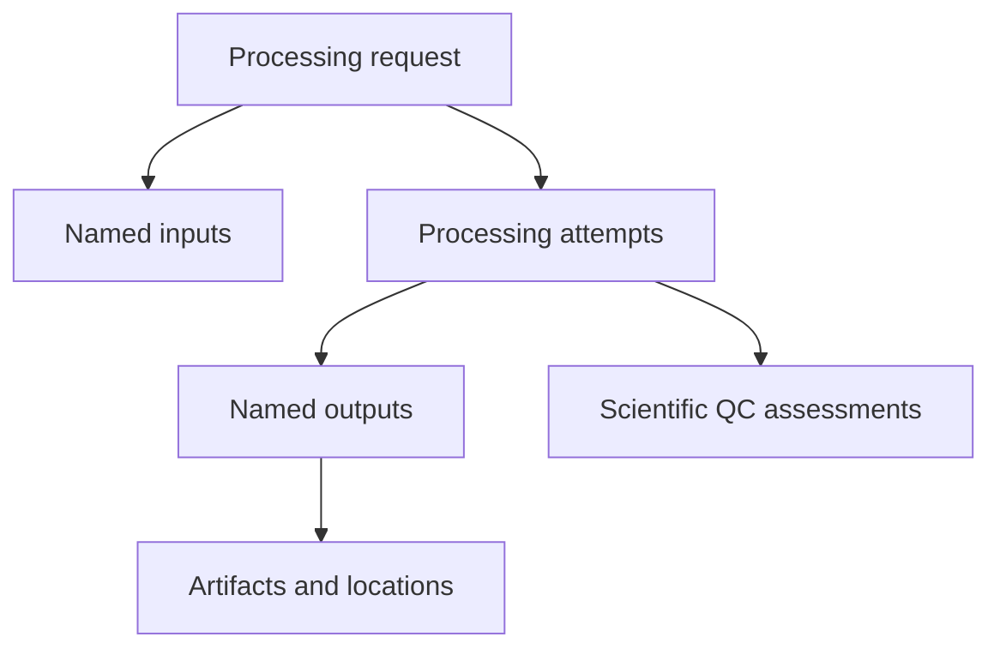

# Schema changes for Version 1

There is no table for each optical index. The processing schema from Lab 04 already supports many products through named roles. The batch schema from Lab 05 already supports multiple requests.

| Existing table | How Version 1 uses it |
|---|---|
| `assets` | Any supported named optical band or SCL; remove the earlier red/NIR-only CHECK constraint |
| `subset_requests`, `download_attempts`, `artifacts`, `artifact_locations` | Keep acquisition requests, history, immutable bytes and their copies |
| `processing_requests` | Product declaration, preparation settings, parameters, grid and exact input/runtime identity in `normalized_json` |
| `processing_inputs` | Any number of input roles, including `green`, `swir16`, and `scl` |
| `processing_attempts` | Execution history; one attempt can write several outputs |
| `processing_outputs` | One row per output role: MNDWI uses `index`, `water`, and `valid_mask` |
| `processing_artifacts`, `processing_artifact_locations` | The output bytes and their current known copies |
| `batches`, `batch_members`, `batch_observations` | Frozen expected work, linked requests and recorded operational observations |

Version 1 adds `scientific_qc_assessments`, the `latest_scientific_qc` view, and a small `processing_schema_migrations` ledger. Each scientific assessment records the producing attempt and request, time, rule version, full policy, outcome, reason and measured metrics. The foreign key ties the assessment to an attempt for the same request.

A new index needs a new product declaration and input/output records, not new columns or tables. A task can succeed, later lose a file, and also have a rejected scientific assessment. Those are different facts. `run` refreshes inspected location statuses without changing succeeded historical attempts. `status` and `report` inspect current files without writing observations; their timestamps describe that inspection. QC assessments remain in history when a newer policy changes the conclusion.

The default rules assess AOI valid fraction, cloud screening and out-of-range counts. Accepted means these recorded checks passed. It does not establish classification accuracy or scientific truth.

The SQL files in `eo_processing/schemas/` are the supplied completed schema. The main lab uses and explains this design rather than making everyone independently redesign it. Keep your diagnostic queries in `queries.sql` or a personal investigation file.
